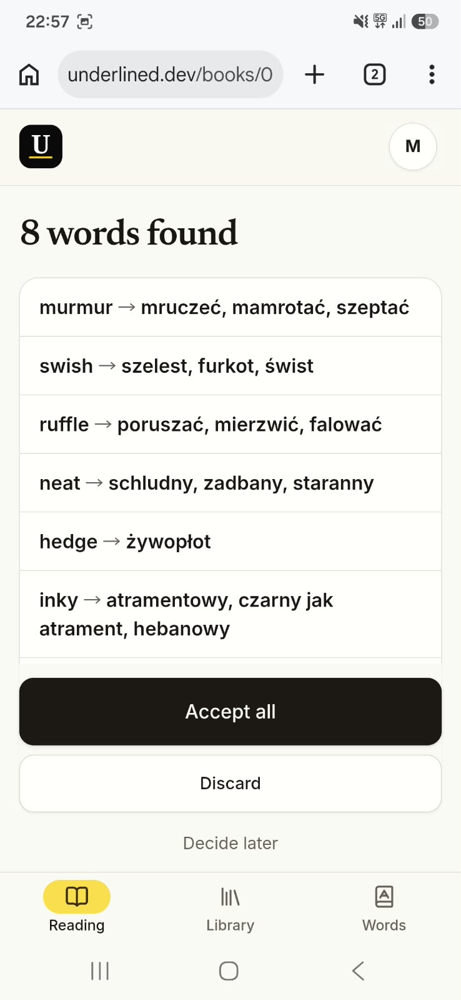

# <ins>Underlined</ins>

**Underline a word in your paper book. Snap a photo. Keep reading.**

Turn the words you underline with a pencil into a personal dictionary — 
each one translated *the way your book uses it*.

### 👉 [Try it now at underlined.dev](https://underlined.dev) 👈

*Works in any phone browser · installable as an app*

 

  

## The problem

Reading in a foreign language on paper is great — until you hit a word you don't know. You can stop and look it up (and lose the flow), skip it (and learn nothing), or promise yourself you'll check later (you won't).

Kindle has a Vocabulary Builder. Paper books had nothing. **Now they do — and the pencil stays.**

## How it works

| 1. Underline | 2. Photograph | 3. Understand | 4. Keep reading |
| :---: | :---: | :---: | :---: |
| Mark unknown words with a pencil while you read. | Take a photo of the page. No book, page or language to enter — one tap. | In ~15 seconds every underlined word appears with its meaning *in that sentence*. | Accept the words and they land on your book's page. Back to the story. |

## See it in action

Say you underlined *glanced* in the first sentence of Stevenson's *Treasure Island*:

> I **glanced** over my shoulder, and my heart jumped against my ribs.

Underlined saves it as the base form with the meaning it has *in that sentence*:

> **glance** → zerknąć, rzucić okiem

Real pencil underlines work too: wobbly, slanted, photographed at an angle on a desk. The app returns a list like this, and you accept it in one tap:

> **murmur** → mruczeć, mamrotać, szeptać
> **swish** → szelest, furkot, świst
> **ruffle** → poruszać, mierzwić, falować
> **neat** → schludny, zadbany, staranny
> **inky** → atramentowy, czarny jak atrament, hebanowy

## Why you'll like it

- 📖 **Real context.** Every word comes with the sentence from *your* book, not a made-up dictionary example.
- 🧠 **Meaning, not the first dictionary entry.** The AI knows the book's title and the sentence, so *bank* is "riverbank" in one place and "bank" in another. It even copes with invented words — *Hatstall*, *Squib*.
- 🔁 **Base forms and repeats.** *fled* is saved as *flee*. Underline it again and you get "met 2×" instead of a duplicate — a hint that this word is worth remembering.
- 📷 **Zero setup per page.** You never type a title, page number or language. Just photograph and go.
- ✏️ **You stay in control.** Review the found words, accept all, discard, or decide later. Edit or delete anything in your library.
- 📤 **Your words are yours.** Export everything to **Anki** or a **CSV** spreadsheet in one tap.
- 📱 **Installable PWA.** Add it to your home screen and it opens full screen with the camera one tap away.

## Learning without pressure

No streaks, no quizzes, nothing is ever overdue. Instead:

- a single, optional **"Remember this?"** card on the reading screen — a sentence from your book with the word highlighted, and the meaning one tap away,
- a **flip-through** of the words from the book you're reading,
- a **Words** tab with everything from every book: original sentences, search, filters and "most often met" sorting,
- a quiet weekly summary,
- **export to Anki or CSV** when you want to study with your own system.

## Try it in 2 minutes

1. Open **[underlined.dev](https://underlined.dev)** on your phone and create an account.
2. Add the book you're reading in the **Library** tab.
3. Underline a few words on a page, tap **Take a photo**, and wait ~15 seconds.
4. Hit **Accept all** — your first words are in the dictionary. (You get 5 page photos a day.)

No paper book at hand? Photograph any printed page with a few pencil marks — a paperback, a magazine, a textbook.

## Supported languages

Books in **English** and **Spanish**, translated to **Polish** or **English**. More on the way.

## Built with

TypeScript monorepo on [fullstack-starter](https://github.com/cieslarmichal/fullstack-starter).

- **Backend:** Fastify, PostgreSQL + Drizzle, S3, Sharp
- **AI:** any vision model through [OpenRouter](https://openrouter.ai) with strict JSON-schema output (Claude Sonnet 5.5 by default, switchable with one config value)
- **Frontend:** React 19, Tailwind, Radix, Vite PWA

The product idea, data model and AI contract live in [`docs/MVP.md`](docs/MVP.md) (in Polish).

## Feedback

Found a bug, a book that confuses it, or have an idea? [Open an issue](https://github.com/cieslarmichal/underlined/issues) — every report helps.

**[Start reading → underlined.dev](https://underlined.dev)**

